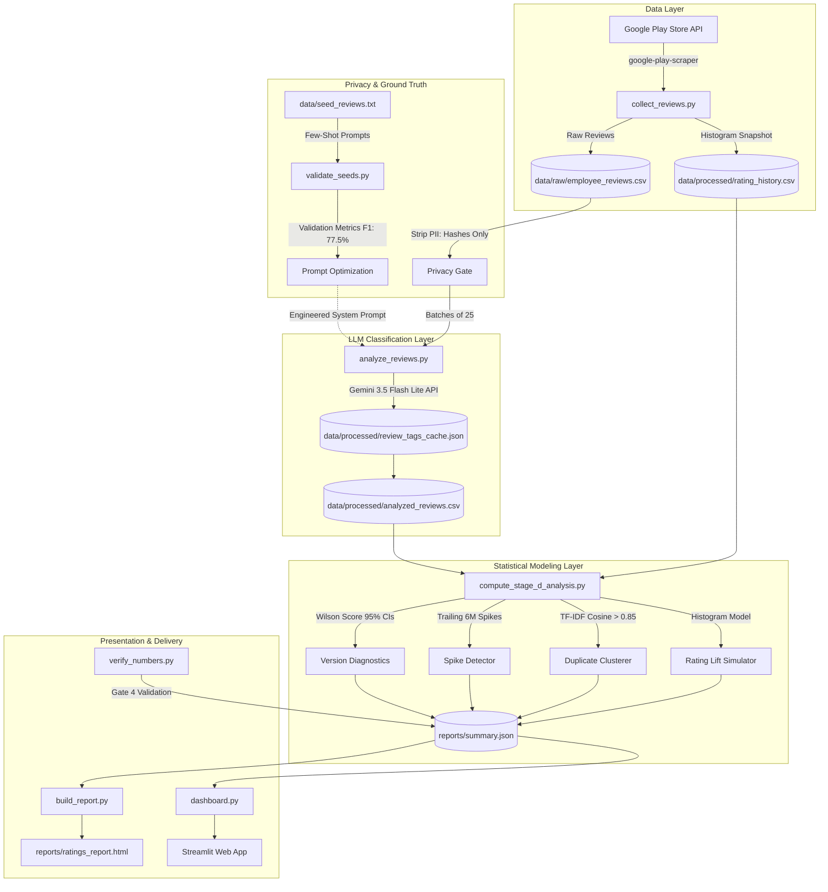

# MoveInSync Play Store Reviews Intelligence Pipeline: Complete Implementation Specification

An end-to-end, LLM-powered feedback intelligence and product analytics platform built for MoveInSync (`com.moveinsync.ets`). This system ingests Play Store reviews, sanitizes user data, performs structured semantic classification using Google Gemini, applies rigorous statistical modeling, and delivers executive reporting via standalone HTML and an interactive Streamlit dashboard.

---

## Table of Contents
1. [Executive Overview & Problem Statement](#1-executive-overview--problem-statement)
2. [End-to-End System Architecture](#2-end-to-end-system-architecture)
3. [Data Ingestion & Preprocessing (`collect_reviews.py`)](#3-data-ingestion--preprocessing-collect_reviewspy)
4. [Taxonomy & Ground-Truth Calibration (`validate_seeds.py`)](#4-taxonomy--ground-truth-calibration-validate_seedspy)
5. [LLM Classification Engine (`analyze_reviews.py`)](#5-llm-classification-engine-analyze_reviewspy)
6. [Statistical Analytics & Quality Diagnostics (`compute_stage_d_analysis.py`)](#6-statistical-analytics--quality-diagnostics-compute_stage_d_analysispy)
7. [Executive Reporting Engine (`build_report.py`)](#7-executive-reporting-engine-build_reportpy)
8. [Interactive Streamlit Dashboard (`dashboard.py`, `ui_theme.py`)](#8-interactive-streamlit-dashboard-dashboardpy-ui_themepy)
9. [Automated Quality Gates & CI (`verify_numbers.py`, GitHub Actions)](#9-automated-quality-gates--ci-verify_numberspy-github-actions)
10. [Repository File Manifest](#10-repository-file-manifest)
11. [Setup & Execution Guide](#11-setup--execution-guide)

---

## 1. Executive Overview & Problem Statement

### 1.1 The Context
MoveInSync is an enterprise employee transport solution managing corporate commutes across major tech hubs. The MoveInSync Android application (`com.moveinsync.ets`) is used daily by thousands of employees for cab tracking, scheduling, pickup verification, and OTP confirmations.

### 1.2 The Core Discovery: The 1-2★ Tail Phenomenon
A surface-level inspection of the Google Play Store listing displays a healthy headline rating of **4.64 / 5.0** across **114,862 lifetime ratings**. However, decomposing the rating histogram reveals a critical dynamic:
- **5 Stars:** 98,191 ratings (85.5%) — Satisfied daily commuters experiencing uninterrupted rides.
- **4 Stars:** 7,272 ratings (6.3%)
- **3 Stars:** 1,235 ratings (1.1%) — Extremely low mediocrity.
- **2 Stars:** 840 ratings (0.7%)
- **1 Star:** 7,324 ratings (6.4%)

Ratings do **not** follow a Gaussian bell curve centered on 3 stars. Instead, sentiment is bimodal: when the app operates smoothly, users give 5 stars; when an acute failure occurs (such as being stranded late at night, an app crash at the pickup gate, or an auto-logout loop), users drop straight into the **8,164-review 1-to-2 star acute tail** (7.1% of total ratings).

### 1.3 Strategic Mission
Replace anecdotal complaint routing with an automated, reproducible intelligence pipeline that:
1. Ingests all Play Store feedback continuously.
2. Extracts structured friction themes with zero heuristic keyword fallbacks using Google Gemini.
3. Distinguishes statistically significant build regressions from normal sample fluctuations.
4. Identifies support bottlenecks and canned response fatigue.
5. Produces validated executive reports and real-time interactive dashboards.

---

## 2. End-to-End System Architecture



---

## 3. Data Ingestion & Preprocessing (`collect_reviews.py`)

### 3.1 Data Acquisition
- **Package:** `com.moveinsync.ets`
- **Region & Language:** `country="in"`, `lang="en"`
- **Library:** `google-play-scraper`
- Ingestion pulls both:
  1. Detailed user reviews with timestamps, version tags, scores, review text, developer replies, and thumbs-up counts.
  2. App-level official metadata: aggregate score, lifetime rating count (114,862), and the complete 5-bin histogram `[7324, 840, 1235, 7272, 98191]`.

### 3.2 24-Month Temporal Boundary & Legacy Isolation
Historical analysis identified that **83.7% of all 2-star reviews** originated prior to October 2024. Legacy app architectures and deprecated backend stacks from 2018–2023 distort modern product priorities.
- **Legacy Boundary:** Reviews submitted before October 9, 2024 (9,205 rows) are flagged with `is_legacy = True` and preserved in raw archives.
- **Active Operational Window:** 5,814 reviews across October 9, 2024 to October 9, 2026 (`is_legacy = False`).

### 3.3 Stratified Corpus Separation
To avoid sampling bias and prevent blending distinct sentiment distributions, the operational sample is partitioned into two isolated groups:
- **`all_1_2_star` Group (N = 1,671):** 100% of all low-star reviews within the 24-month window. Evaluated exhaustively for friction causes.
- **`random_3_5_star` Group (N = 1,500):** A stratified random sample of positive and neutral reviews used to benchmark response rates and measure feature praises.
- **Total Analyzed Corpus:** **3,171 reviews** (100% LLM-tagged).

### 3.4 Zero-PII Compliance & Privacy Gate
Reviewer usernames, email handles, and avatar URLs are completely stripped during ingestion. Each review is tracked strictly by its cryptographic Play Store `reviewId` GUID.

---

## 4. Taxonomy & Ground-Truth Calibration (`validate_seeds.py`)

### 4.1 Domain Taxonomy (17 Themes)
A standardized, mutually exclusive classification taxonomy designed specifically for corporate commute workflows:

| Theme Name | Description & Inclusions |
|---|---|
| `LOGIN_OTP` | Auto-logout loops, missing OTP fields, expired tokens, SMS delivery lag, empty body on launch |
| `APP_CRASH_OPEN` | Force close on launch, frozen white screens, "App not installed" post-update errors |
| `LOCATION_ETA` | GPS drifting, frozen driver markers, arrival estimate jumping, vehicle standing still |
| `SLOW_PERFORMANCE` | UI unresponsiveness, slow trip schedule screen, hanging network calls |
| `BOOKING` | Schedule cutoff barriers, waitlist opacity, seat booking glitches, missing QR passes |
| `UI_REDESIGN` | Seatbelt popup modal before OTP, confusing layouts, complaints about new updates |
| `SUPPORT` | Transport helpdesk unresponsive, unanswered support tickets, escalations ignored |
| `ROUTING_STOPS` | Circuitous detour routes, suboptimal stop sequences, unnecessary highway diversions |
| `RATING_FEEDBACK` | Mandatory post-ride feedback popups blocking screen navigation, skip button missing |
| `DRIVER_CONTACT` | Masked call failure, driver phone number missing after allocation, call disconnected |
| `NO_SHOW` | Driver marks commuter as no-show without waiting or calling; geofence bypass |
| `NOTIFICATIONS` | False "trip unbooked" push alerts, spam notifications, late cab assignment alerts |
| `PERMISSIONS` | Aggressive background location permission prompts, battery optimization blocks |
| `PARKING_SEAT` | Office shuttle seat reservations, corporate campus parking allocation bugs |
| `OTHER_DRIVER_BEHAVIOUR` | Rude driver demeanor, rash driving, AC refusal, unauthorized co-passengers |
| `NO_DETAIL` | Generic one-word frustration ("worst app", "bad", "useless") lacking actionable root causes |
| `POSITIVE` | Praise for punctual drivers, smooth rides, or seamless booking |

### 4.2 Seed Corpus (`data/seed_reviews.txt`)
Contains **110 curated reviews** (`[R001]` to `[R110]`), each labeled with ground-truth primary themes, secondary themes, sentiment, severity (1–5), feature request flags, and concise summaries.

### 4.3 Validation Protocol (`validate_seeds.py`)
- **Split:** Deterministic train/test split with `seed=42`:
  - **40 Few-Shot Examples:** Embedded in the prompt for model context and calibration.
  - **70 Held-Out Evaluation Reviews:** Never shown to the model during training.
- **Observed Validation Results:**
  - **At-least-one-theme Match Rate:** **98.6%** (69 out of 70 reviews).
  - **Macro F1 Score:** **77.5%** across active categories (comfortably surpassing the 70.0% validation gate).
  - **Disagreement Audit:** Exactly 1 zero-match review (`R008`), and 33 multi-label nuance differences. Known annotator limits were recorded for `DRIVER_CONTACT` (50% F1) and `ROUTING_STOPS` (44% F1) due to annotator overlap with `LOCATION_ETA`.

---

## 5. LLM Classification Engine (`analyze_reviews.py`)

### 5.1 Model & Configuration
- **Model:** Google `gemini-3.5-flash-lite` (via `google-generativeai`).
- **Mode:** Structured JSON Output Schema.
- **Batching:** 25 reviews per request for optimal throughput and token packing.
- **Rate Limit & Retry Policy:** Exponential backoff (`2s`, `4s`, `8s`, `16s`) handling transient HTTP 429/503 responses.

### 5.2 Structured Schema Definition
For every review, the model returns a typed JSON object:
```json
{
  "reviewId": "string",
  "primary_theme": "STRING (from KNOWN_THEMES)",
  "themes": ["STRING", "STRING"],
  "sentiment": "negative | neutral | positive",
  "severity": 1.0,
  "is_feature_request": true,
  "summary": "Concise 10-word technical problem statement"
}
```

### 5.3 Local Disk Caching
All LLM inferences are cached in `data/processed/review_tags_cache.json` indexed by `reviewId`. Re-running the pipeline loads cached classifications in under 2 seconds, guaranteeing idempotency and zero unnecessary API billing.

### 5.4 Elimination of Keyword Fallbacks
All 3,171 reviews are tagged directly by the LLM. Rule-based regex/keyword categorizers are strictly banned, avoiding misclassification of complex multi-clause reviews (e.g., distinguishing *"driver OTP failed"* from *"driver was rude"*).

---

## 6. Statistical Analytics & Quality Diagnostics (`compute_stage_d_analysis.py`)

### 6.1 Theme Share Formulations
1. **Share of All 1-2★ Reviews (N = 1,671):**
   $$\text{Share}_{\text{all}} = \frac{\text{Count}(\text{Theme})}{1671} \times 100$$
2. **Share of Actionable Reasons Only (N = 1,419):**
   Excludes `NO_DETAIL` (224 reviews) and `POSITIVE` (28 reviews) to focus engineering strictly on solvable friction:
   $$\text{Share}_{\text{reasons}} = \frac{\text{Count}(\text{Theme})}{1419} \times 100$$

**Top Actionable Themes Breakdown:**
- **LOGIN_OTP:** 245 reviews (**17.3%** of reasons)
- **APP_CRASH_OPEN:** 147 reviews (**10.4%** of reasons)
- **LOCATION_ETA:** 145 reviews (**10.2%** of reasons)
- **SLOW_PERFORMANCE:** 134 reviews (**9.4%** of reasons)
- **BOOKING:** 132 reviews (**9.3%** of reasons)
- **UI_REDESIGN:** 103 reviews (**7.3%** of reasons)
- **SUPPORT:** 86 reviews (**6.1%** of reasons)
- **ROUTING_STOPS:** 78 reviews (**5.5%** of reasons)

### 6.2 Monthly Trend & Spike Detection
- Tracks volume monthly over 24 months with a **3-Month Rolling Average**.
- **Spike Detection Formula:** Flags a theme in month $m$ if:
  $$\text{Count}(m) \ge 8 \quad \text{AND} \quad \text{Share}(m) \ge 2.0 \times \text{Mean}(\text{Share}_{m-6 \dots m-1})$$
- **Detected Spikes:**
  - `APP_CRASH_OPEN` in **August 2026** (13.0% share vs. 5.1% trailing avg) coinciding with builds `12.18.0` / `12.19.0`.
  - `APP_CRASH_OPEN` in **September 2026** (19.1% share vs. 6.7% trailing avg) coinciding with build `12.19.0`.

### 6.3 Version Diagnostics & Sample Bias Elimination
Previous release evaluations suffered from sample bias by calculating simple arithmetic mean scores on small sample sizes. 

**Correct Statistical Formulation:**
1. **Chronological Semver Ordering:** Parses version strings strictly via `packaging.version.parse`.
2. **Sample Volume Threshold:** $n \ge 100$ reviews required to evaluate a build.
3. **Wilson Score 95% Confidence Intervals:**
   $$\text{CI}_{95\%} = \hat{p} \pm 1.96 \sqrt{\frac{\hat{p}(1 - \hat{p})}{n}}$$
4. **Neighbour-Pooled Comparison:** Compares version $v_i$ against pooled neighbouring builds $(v_{i-1}, v_{i+1})$. A drop is statistically significant **only** if the 95% confidence intervals do not overlap:
   $$\text{CI}_{\text{low}}(v_i) > \text{CI}_{\text{high}}(\text{Neighbours})$$

**The Case of v12.19.0:**
In build `v12.19.0` ($n=102$), the 1-2 star share rose to **35.3%** (vs 29.8% pooled neighbours). However, its 95% confidence interval `[26.0%, 44.6%]` overlaps with the neighbouring pooled interval `[22.2%, 37.3%]`. The statistical evidence for a version-level drop is formally documented as **inconclusive**.

### 6.4 Developer Support Metrics
- **1-2★ Reply Rate:** **4.1%** (69 of 1,671 answered).
- **Median Turnaround Time:** **6.2 days** (148.9 hours).
- **Canned Template Analysis:** Repetitive response clustering flags that **26.2%** of developer replies (27 of 103 total replies) are identical copy-paste templates repeated $\ge 3$ times.

### 6.5 Near-Duplicate Review Clustering
- Filters reviews with $\ge 15$ words.
- Computes **TF-IDF Character & Word n-grams** and pairwise **Cosine Similarity**.
- Reviews with similarity $> 0.85$ are flagged. (Detected: 0 suspicious bot syndicates, confirming organic human feedback).

### 6.6 Rating Lift Simulation (Histogram Scaling Model)
Calculates projected Play Store rating gains if specific friction themes are resolved:
$$\Delta \text{Stars} = \frac{\text{Ratings Affected} \times (4.0 - \bar{x}_{1\text{-}2})}{N_{\text{lifetime}}}$$
Where:
- $N_{\text{lifetime}} = 114,862$
- $\bar{x}_{1\text{-}2} = 1.15$
- Star lift delta per resolved review $= 2.85$ stars.
- **Realistic Gain:** Resolving the top 3 volume themes (`LOGIN_OTP`, `APP_CRASH_OPEN`, `LOCATION_ETA`) lifts the headline rating by **+0.06 to +0.09 stars**.
- **Theoretical Upper Bound:** Converting all 8,164 lifetime 1-2★ ratings to 4 stars yields **~4.88 stars**.

---

## 7. Executive Reporting Engine (`build_report.py`)

Generates a standalone, self-contained executive HTML report at `reports/ratings_report.html`:
- **File Footprint:** ~29 KB single-file HTML.
- **Zero External Dependencies:** Built with inline CSS, embedded SVG vector charts, and zero external CDN script dependencies. Runs offline and in restricted corporate intranets.
- **Structure:**
  - Executive KPI Ribbon (Headline score, lifetime ratings, tail percentage, 24M sample count).
  - Voice of the Commuter curated quote cards.
  - Interactive Tabular Breakdowns for themes, spikes, and version diagnostics.
  - Prioritized engineering fix matrices linked directly to `RECOMMENDATIONS.md`.

---

## 8. Interactive Streamlit Dashboard (`dashboard.py`, `ui_theme.py`)

### 8.1 Multi-Page Architecture
The dashboard runs via `streamlit run dashboard.py` with 5 dedicated operational views:
1. **📊 Overview:** Hero animated banner with count-up metrics, lifetime rating histogram breakdown, and 24-month monthly review volume chart.
2. **⚠️ Why Ratings Are Low:** Tabbed root cause explorer (Reasons Only, All 1-2★ Breakdown, Rating Lift Simulator, and commuter quotes).
3. **🚀 Releases:** Chronological semver quality diagnostics table with 95% CIs, inconclusive version notes, and monthly theme spike alerts.
4. **💬 Support & Replies:** Support response rates across rating tiers, median turnaround delay, canned template detection, and duplicate review viewer.
5. **🔍 Review Explorer:** Multi-dimensional filterable review grid with real-time text query search and anonymized privacy hashes.

### 8.2 Dual-Theme Engine (`ui_theme.py` & `.streamlit/config.toml`)
- Fully supports Streamlit's native Settings menu (**System / Light / Dark**).
- **Styling Architecture:**
  - Injected as a single `<style>` block at the top via `ui_theme.inject_theme()`.
  - Zero iframe boundaries: Replaced all `st.components.v1.html` blocks with pure `st.markdown(..., unsafe_allow_html=True)` to prevent iframe clipping, font mismatch, and scrollbars.
  - Card backgrounds: `background: rgba(127, 127, 127, 0.12)`.
  - Card borders: `border: 1px solid rgba(127, 127, 127, 0.25)`.
  - Accent colors: `var(--primary-color, #06b6d4)`.
  - Typography: `font-family: inherit; color: inherit;`.
  - Micro-animations: Smooth 0.4s fade-ins strictly respecting `@media (prefers-reduced-motion: reduce)`.

### 8.3 Zero-Indentation Markdown Standard
To prevent Markdown parsers from interpreting HTML code as indented `<pre><code>` blocks, all generated HTML strings in `ui_theme.py` and `dashboard.py` enforce zero leading indentation on every tag.

### 8.4 Sidebar Filter Defaults & Reset Action
- **App Version:** Empty `[]` on first load (= all versions included).
- **Date Range:** Full data span (`2024-10-09` to `2026-10-09`).
- **Star Rating:** All 5 stars selected `[1, 2, 3, 4, 5]`.
- **First Load Count:** Prominently displays **Matching Reviews: 3,171**.
- **Reset Filters Button:** Automatically restores all widgets to defaults via session state callbacks.

---

## 9. Automated Quality Gates & CI (`verify_numbers.py`, GitHub Actions)

### 9.1 Gate 4 Verification (`verify_numbers.py`)
An automated integrity validator that executes 31 assertion checks cross-referencing `reports/summary.json`, `RECOMMENDATIONS.md`, and `reports/ratings_report.html`:
- Sample sizes ($N = 1,671$ low-star, $N = 1,419$ reasons, $N = 1,500$ high-star).
- Top theme review counts and exact percentages (e.g., `LOGIN_OTP` 245 reviews / 17.3%).
- Support response metrics (4.1% reply rate, 6.2-day median delay, 26.2% canned share).
- Headline ratings (4.64 stars across 114,862 ratings).
- Exits with return code `0` on 100% agreement, or halts with `1` on discrepancy.

### 9.2 Weekly Automation (`.github/workflows/weekly_ratings.yml`)
- Triggers every **Monday at 06:00 UTC** and supports manual dispatch.
- Executes `python run_all.py` end-to-end on GitHub runners.
- Commits updated rating snapshots and uploads `reports/ratings_report.html` as an artifact.

---

## 10. Repository File Manifest

```text
moveinsync-ratings/
│
├── .github/workflows/
│   └── weekly_ratings.yml        # Weekly automated GitHub Actions pipeline
├── .streamlit/
│   └── config.toml               # Streamlit dual-theme configuration (primaryColor: #06b6d4)
│
├── data/
│   ├── raw/
│   │   └── employee_reviews.csv  # Raw Play Store reviews (Git-ignored)
│   ├── processed/
│   │   ├── analyzed_reviews.csv  # Full classified reviews corpus (N=3,171)
│   │   ├── rating_history.csv    # Official Play Store rating & histogram snapshots
│   │   └── review_tags_cache.json# Local LLM classification cache (Git-ignored)
│   └── seed_reviews.txt          # 110 curated ground-truth calibration reviews
│
├── reports/
│   ├── ratings_report.html       # Standalone executive HTML report
│   ├── summary.json              # Source-of-truth statistical summary
│   └── theme_quotes.json         # Curated commuter quotes by friction theme
│
├── scripts/
│   └── dev/                      # Internal calibration and migration utilities
│
├── analyze_reviews.py            # Gemini 3.5 Flash Lite batch classification engine
├── build_report.py               # Self-contained HTML report compiler
├── collect_reviews.py            # Play Store scraper & histogram collector
├── compute_stage_d_analysis.py   # Statistical analytics, CIs, spikes & lift modeling
├── config.py                     # Global paths, theme definitions, and environment loader
├── dashboard.py                  # Full-featured Streamlit analytics application
├── ui_theme.py                   # Dual-theme styling engine & zero-indent HTML generators
├── run_all.py                    # Master pipeline orchestrator with 10-line executive readout
├── validate_seeds.py             # Ground-truth validation script (Macro F1: 77.5%)
├── verify_numbers.py             # Gate 4 consistency assertion suite (31 checks)
├── test_near_duplicates.py       # Unit tests for TF-IDF duplicate review detector
├── test_version_drops.py         # Unit tests for Wilson score 95% CI drop algorithm
│
├── DEMO_SCRIPT.md                # 2-minute executive walkthrough presentation script
├── IMPLEMENTATION.md             # Complete technical architecture & implementation reference
├── README.md                     # High-level overview and quick-start guide
├── RECOMMENDATIONS.md            # Prioritized engineering fix matrix & ROI roadmap
├── SUBMISSION_NOTES.md           # Submission methodology and project summary
└── requirements.txt              # Pinned Python package dependencies
```

---

## 11. Setup & Execution Guide

### 11.1 Prerequisites
- Python 3.10 to 3.13
- A Google Gemini API Key (stored in `.env`)

### 11.2 Environment Setup
```bash
# 1. Clone repository
git clone https://github.com/AnuradhaKashaudhan/MOVEINSYNC.git
cd MOVEINSYNC/moveinsync-ratings

# 2. Create virtual environment & install dependencies
python -m venv venv
source venv/bin/activate  # On Windows: venv\Scripts\activate
pip install -r requirements.txt

# 3. Configure Gemini API Key
echo "GEMINI_API_KEY=your_gemini_api_key_here" > .env
```

### 11.3 Running the Pipeline
```bash
# Execute end-to-end pipeline (Data Ingestion -> Statistical Modeling -> Report Generation)
python run_all.py

# Run quality verification assertions
python verify_numbers.py

# Launch interactive dashboard
streamlit run dashboard.py
```
Dashboard will be available at `http://localhost:8501`.
