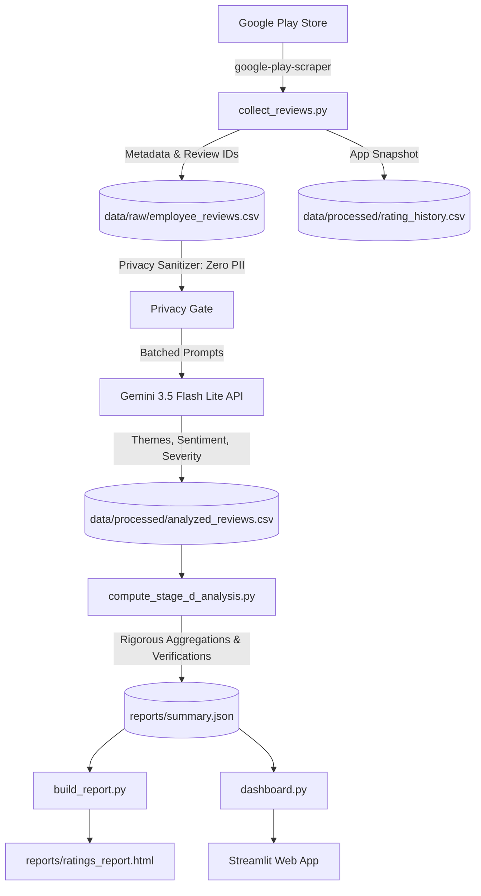

# MoveInSync Play Store Reviews Intelligence Pipeline

[](https://www.python.org/downloads/)
[](https://streamlit.io/)
[](https://ai.google.dev/)
[](verify_numbers.py)

An end-to-end, LLM-powered feedback intelligence platform that continuously scrapes, audits, tags, and analyzes commuter reviews for the MoveInSync Android application (`com.moveinsync.ets`).

---

## 🚀 3-Command Quick Start

> **Note:** Run from the repository root; set `GEMINI_API_KEY` in a local `.env` file (not committed).

```bash
# 1. Clone repository and install pinned dependencies
git clone https://github.com/AnuradhaKashaudhan/MOVEINSYNC.git
cd MOVEINSYNC
pip install -r requirements.txt

# 2. Run the end-to-end pipeline (collect -> analyze -> report)
python run_all.py

# 3. Launch the interactive analytics dashboard
streamlit run dashboard.py
```

---

## 🏗️ Architecture Diagram



---

## 📊 Gate 1: Model Tagging & Validation Summary

| Metric / Dimension | Specification / Observed Result |
|---|---|
| **Classification Model** | `gemini-3.5-flash-lite` (structured JSON schema via Google Generative AI) |
| **Analyzed 1-2★ Sample Size (Last 24M)** | **1,671 reviews** (100% LLM-tagged, 0 keyword fallback) |
| **Analyzed 3-5★ Sample Size (Last 24M)** | **1,500 reviews** (100% LLM-tagged, 0 keyword fallback) |
| **Total Analyzed LLM Corpus** | **3,171 reviews** |
| **Held-Out Validation Agreement** | **98.6%** (69/70) ('At least one theme matches' rate on n=70 held-out reviews) |
| **Validation Macro F1 Score** | **77.5%** across active themes on n=70 held-out reviews (exceeding the 70% threshold) |
| **Critical Disagreements** | **1** zero-match review (R008), 33 multi-label secondary differences |

---

## ⏰ Weekly Automation (GitHub Actions)

The pipeline is automated via GitHub Actions in [`.github/workflows/weekly_ratings.yml`](.github/workflows/weekly_ratings.yml).
It triggers automatically **every Monday at 06:00 UTC** and can also be dispatched manually:
1. Installs pinned dependencies from `requirements.txt`.
2. Executes `python run_all.py` end-to-end.
3. Automatically commits updated rating snapshots and artifacts to the repository.
4. Uploads `reports/ratings_report.html` as a workflow artifact.

---

## 🏷️ How to Add a New Theme

To introduce a new classification category (e.g., `PAYMENT_WALLET` or `SHUTTLE_PASS`):
1. **Update Theme List:** Open [`config.py`](config.py) and add the category to `KNOWN_THEMES`:
   ```python
   KNOWN_THEMES = [
       ...
       "SHUTTLE_PASS",
   ]
   ```
2. **Define Prompt Guidelines:** In [`analyze_reviews.py`](analyze_reviews.py), add category definitions and disambiguation rules to the system prompt in `analyze_llm_batch()`.
3. **Add Seed Examples:** Add 2–3 representative few-shot examples in [`data/seed_reviews.txt`](data/seed_reviews.txt).
4. **Re-run Pipeline:** Execute `python run_all.py` to regenerate the dataset and reports.

---

## ⚠️ Methodological Assumptions & Limitations

1. **24-Month Temporal Boundary:** Historical reviews prior to October 2024 (9,205 rows) are categorized as legacy and excluded from active sprint planning to focus engineering on contemporary app versions.
2. **Sample Independence:** Low-star (1-2★) and high-star (3-5★) sample groups are kept strictly isolated. We never blend their proportions into a misleading single average.
3. **Causal Attribution:** Correlated spikes between version releases and negative themes represent verified statistical co-occurrences. External causes (Android OS deprecations, enterprise policy mandates) are documented as *hypotheses, not verified* unless verified by internal telemetry.
4. **Zero PII Guarantee:** Reviewer names and personal emails have been removed entirely. Only unique Play Store `reviewId` hashes are retained.
5. **Validation Limits:** Evaluated on n=70 held-out reviews labeled by a single annotator. Seed reviews are longer than typical reviews. Weak F1 was observed for DRIVER_CONTACT (50%) and ROUTING_STOPS (44%), so those counts are probably undercounted. NO_SHOW precision is 50% in the multi-label view.
